<!-- AP/2717 — Original SVG interface for Arun Prasath. No external card services. -->

  

<!-- Accessible, searchable profile copy. -->
I’m a Computer Science and Engineering student exploring the intersection of machine learning, infrastructure and software engineering. My focus is **MLOps, applied AI/ML and backend engineering**: building reproducible workflows, serving models through APIs, automating delivery and improving system reliability.

[VOILORACLE](https://github.com/Arunprasath-2717/VOILORACLE) · [Application](https://veiloracle.vercel.app/) &nbsp; / &nbsp; [VerifAI](https://github.com/Arunprasath-2717/VerifAI) · [Application](https://verifai-mauve.vercel.app/)

[NexusCloud-Orchestra](https://github.com/Arunprasath-2717/NexusCloud-Orchestra) &nbsp; / &nbsp; [CadastraVision](https://github.com/Arunprasath-2717/CadastraVision)

[Projexa](https://github.com/Arunprasath-2717/Projexa) · [Application](https://projexa-blond.vercel.app/) &nbsp; / &nbsp; [Portfolio](https://github.com/Arunprasath-2717/Portfolio) · [Website](https://arunprasath.me)

Telemetry is generated from GitHub's API and refreshed on a six-hour schedule after Actions is enabled. Repository counts exclude forks and this profile repository; initial sample is explicitly marked. Contribution data depends on GitHub visibility and API access.

[Portfolio](https://arunprasath.me) · [LinkedIn](https://www.linkedin.com/in/arun-prasath-p-6ar01333/) · [GitHub](https://github.com/Arunprasath-2717)

AP / 2717 · Independent engineering identity · Designed as code

