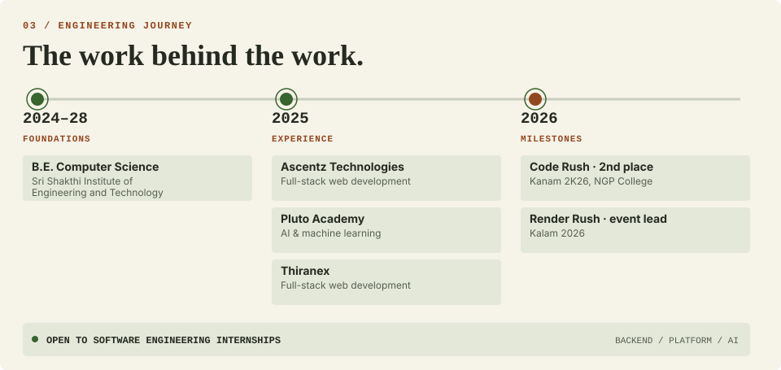

<!-- AP/2717 • Night Shift • Original SVG artwork, generated locally. -->
<picture>
  <source media="(prefers-color-scheme: dark)" srcset="assets/identity-dark.svg">
  
</picture>

[Portfolio](https://arunprasath.me) · [LinkedIn](https://www.linkedin.com/in/arun-prasath-p-6ar01333/) · [LeetCode](https://leetcode.com/u/_Arun_Prasath_07_/) · [Email](mailto:arunprasath6035@gmail.com)

I'm a CSE student working at the intersection of backend systems and applied machine learning. I like building the parts that turn unstructured input into something you can use, inspect and deploy: retrieval, processing pipelines, APIs and the infrastructure around them.

My next frontier is MLOps — reproducible training, model versioning, containerized serving and observability.

## 01 — Selected systems

<a href="https://github.com/Arunprasath-2717/VerifAI">
  <picture>
    <source media="(prefers-color-scheme: dark)" srcset="assets/verifai-dark.svg">
    
  </picture>
</a>

**VerifAI** — compares AI answers, extracts checkable claims and traces verdicts to evidence. Independent judges and local BM25 retrieval help preserve uncertainty rather than confuse agreement with truth.

[Source](https://github.com/Arunprasath-2717/VerifAI) · [Case study](https://arunprasath.me/work/verifai) · [Application](https://verifai-mauve.vercel.app/)

<a href="https://github.com/Arunprasath-2717/VOILORACLE">
  <picture>
    <source media="(prefers-color-scheme: dark)" srcset="assets/atlox-dark.svg">
    
  </picture>
</a>

**Atlox AI (VOILORACLE)** — aggregates news, deduplicates coverage and discovers events using NLP. Density-based clustering handles an unknown number of events; a Redis queue separates ingestion from processing, with an in-memory fallback for local runs.

[Source](https://github.com/Arunprasath-2717/VOILORACLE) · [Case study](https://arunprasath.me/work/atlox-ai) · [Application](https://veiloracle.vercel.app/)

## 02 — Skills & engineering

<picture>
  <source media="(prefers-color-scheme: dark)" srcset="assets/toolchain-dark.svg">
  
</picture>

## 03 — The journey

<picture>
  <source media="(prefers-color-scheme: dark)" srcset="assets/journey-dark.svg">
  
</picture>

## 04 — Development activity

<picture>
  <source media="(prefers-color-scheme: dark)" srcset="assets/activity-dark.svg">
  
</picture>

Updated from GitHub every six hours. <a href="data/contributions.json">Raw weekly data</a> · Artwork and project animations are illustrations, not live operational metrics.

---

Open to software engineering internships in backend, platform and applied AI.

[Portfolio](https://arunprasath.me) · [All repositories](https://github.com/Arunprasath-2717?tab=repositories) · [LinkedIn](https://www.linkedin.com/in/arun-prasath-p-6ar01333/)
