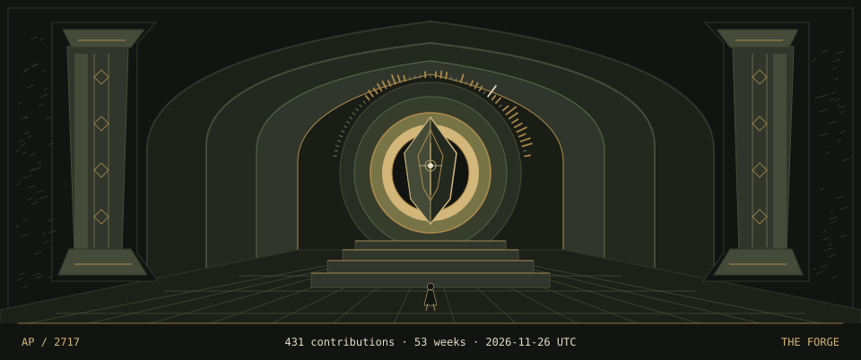

# Arun Prasath

**MLOps · Applied AI · Backend Engineering**

I'm a computer science student interested in how models become reliable software: data pipelines, model serving, deployment and backend systems.

## Selected work

**[VerifAI](https://github.com/Arunprasath-2717/VerifAI)** — Compare AI answers and inspect claim-level evidence. [Application](https://verifai-mauve.vercel.app/)

**[VOILORACLE](https://github.com/Arunprasath-2717/VOILORACLE)** — News ingestion, event analysis and sentiment intelligence. [Application](https://veiloracle.vercel.app/)

[Portfolio](https://arunprasath.me) · [LinkedIn](https://www.linkedin.com/in/arun-prasath-p-6ar01333/) · [All repositories](https://github.com/Arunprasath-2717?tab=repositories)

The Forge is drawn in SVG. The engraved marks encode actual weekly GitHub contributions and refresh every six hours.
