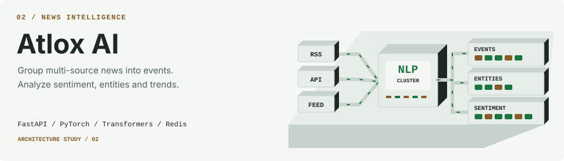
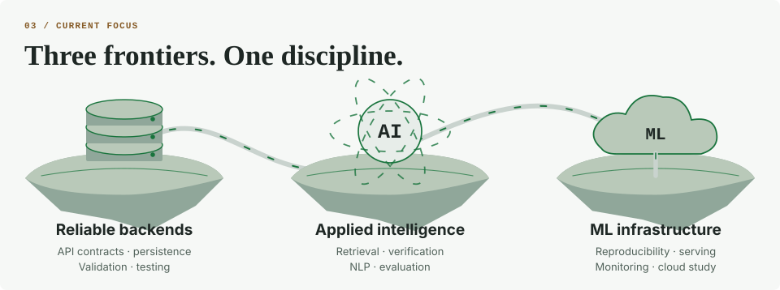
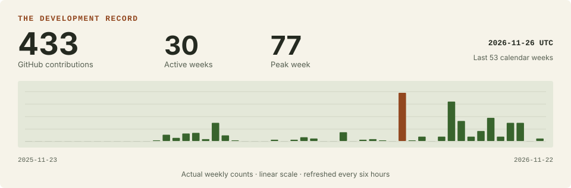

<!-- AP/2717. Artwork and technical animations are stored in this repository. -->
<picture>
  <source media="(prefers-reduced-motion: reduce)" srcset="assets/ruins-still.svg">
  
</picture>

[Portfolio](https://arunprasath.me) · [LinkedIn](https://www.linkedin.com/in/arun-prasath-p-6ar01333/) · [LeetCode](https://leetcode.com/u/_Arun_Prasath_07_/) · [Email](mailto:arunprasath6035@gmail.com)

I'm a computer science student in India. I work on Python backends and applied machine learning, particularly retrieval, information extraction and systems that need to explain how they reached a decision. I'm learning how to make those systems reproducible, deployable and observable.

## Selected work

### [VerifAI](https://github.com/Arunprasath-2717/VerifAI)

An evidence-first verification system for comparing AI answers. It extracts checkable claims, retrieves supporting material and preserves uncertainty through independent review and an explicit unknown state. Local BM25 retrieval provides a fallback.

<a href="https://github.com/Arunprasath-2717/VerifAI"><picture>
  <source media="(prefers-color-scheme: dark)" srcset="assets/verifai-dark.svg">
  
</picture></a>

`Python` `FastAPI` `PostgreSQL` `BM25` `Pytest` · [Case study](https://arunprasath.me/work/verifai) · [Application](https://verifai-mauve.vercel.app/)

### [Atlox AI / VOILORACLE](https://github.com/Arunprasath-2717/VOILORACLE)

A news intelligence pipeline. It ingests and deduplicates coverage, extracts entities and sentiment, then groups related reports into events. Density-based clustering avoids requiring a predetermined number of clusters; Redis-backed processing has a local in-memory fallback.

<a href="https://github.com/Arunprasath-2717/VOILORACLE"><picture>
  <source media="(prefers-color-scheme: dark)" srcset="assets/atlox-dark.svg">
  
</picture></a>

`Python` `FastAPI` `NLP` `Redis` `Clustering` · [Case study](https://arunprasath.me/work/atlox-ai) · [Application](https://veiloracle.vercel.app/)

### [CANE](https://github.com/Arunprasath-2717/CANE)

Context-Aware Notification Engine. It uses per-user context, historical retrieval and deterministic scoring to decide whether an incoming message should notify, digest or mute. Decisions include explanations and evidence IDs; the core inference pipeline doesn't require an external LLM.

<a href="https://github.com/Arunprasath-2717/CANE"><picture>
  <source media="(prefers-color-scheme: dark)" srcset="assets/cane-dark.svg">
  
</picture></a>

`Python` `TF-IDF` `RapidFuzz` `Rules` · [Case study](https://arunprasath.me/work/cane)

Project visuals show illustrative examples, not recorded production traffic or measured results.

## Skills and engineering practice

<picture>
  <source media="(prefers-reduced-motion: reduce)" srcset="assets/river-landscape.webp">
  
</picture>

**Languages:** Python, Java, TypeScript, JavaScript, C/C++, SQL

**Backend:** FastAPI, Flask, Node.js, REST, SQLAlchemy, JWT

**Applied AI:** PyTorch, Transformers, spaCy, scikit-learn, OpenCV, retrieval, evaluation

**Data:** PostgreSQL, PostGIS, Redis, SQLite, MongoDB, Supabase

**Linux and delivery:** Linux, Docker, Git, GitHub Actions, CI/CD, Pytest, Ruff, Mypy

**Web:** React, Next.js, Vite, HTML, CSS, WebSockets

<picture>
  <source media="(prefers-color-scheme: dark)" srcset="assets/toolchain-dark.svg">
  
</picture>

## Current focus

I'm working toward better API contracts, testable inference services and repeatable deployments. My current learning areas are Kubernetes, Terraform, AWS, model registries, experiment tracking and observability.

<picture>
  <source media="(prefers-color-scheme: dark)" srcset="assets/focus-dark.svg">
  
</picture>

<picture>
  <source media="(prefers-color-scheme: dark)" srcset="assets/lifecycle-dark.svg">
  
</picture>

## Development activity

<picture>
  <source media="(prefers-color-scheme: dark)" srcset="assets/activity-dark.svg">
  
</picture>

<picture>
  <source media="(prefers-color-scheme: dark)" srcset="assets/snake-dark.svg">
  
</picture>

Updated from GitHub every six hours. [Weekly counts](data/contributions.json) · [Snake generator](https://github.com/Platane/snk) · [Artwork and build notes](SETUP.md)

---

Open to software engineering internships in backend, platform engineering and applied AI.

[Portfolio](https://arunprasath.me) · [Repositories](https://github.com/Arunprasath-2717?tab=repositories) · [LinkedIn](https://www.linkedin.com/in/arun-prasath-p-6ar01333/)
