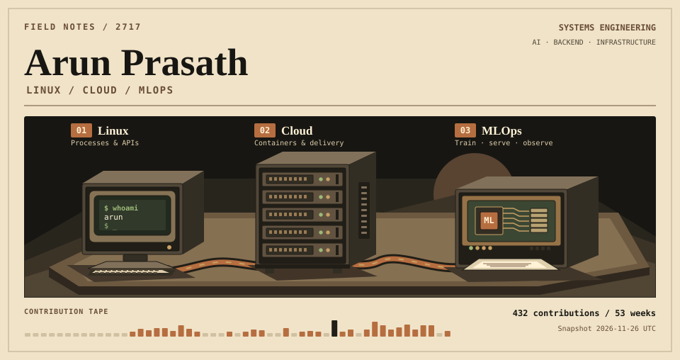

  

I am a computer science student interested in the infrastructure behind intelligent software — from a process running on Linux to a service running in the cloud.

### From shell to service

| Linux & backend | Cloud & delivery | MLOps & AI |
| :--- | :--- | :--- |
| Python, FastAPI, PostgreSQL | Docker, Kubernetes, GitHub Actions | Model serving, reproducibility, evaluation |

I focus on the connection between these layers: reliable APIs, reproducible pipelines, automated deployments and observable systems.

### Selected work

**[VerifAI](https://github.com/Arunprasath-2717/VerifAI)** 
Compare AI model answers, inspect claim-level evidence and retain an audit trail. 
`Python` · `FastAPI` · `PostgreSQL` · [Application](https://verifai-mauve.vercel.app/)

**[VOILORACLE](https://github.com/Arunprasath-2717/VOILORACLE)** 
Multi-source news ingestion, event analysis and sentiment intelligence. 
`Python` · `NLP` · `Data pipelines` · [Application](https://veiloracle.vercel.app/)

---

[Portfolio](https://arunprasath.me) · [LinkedIn](https://www.linkedin.com/in/arun-prasath-p-6ar01333/) · [All repositories](https://github.com/Arunprasath-2717?tab=repositories)

The artwork is generated from SVG source. The contribution tape uses GitHub's weekly contribution counts and refreshes every six hours; the workshop itself is an illustration, not a live service monitor.
