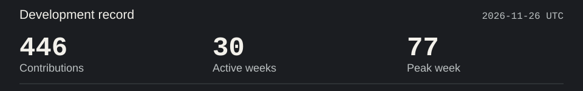

<!-- AP/2717 • self-contained motion graphics and measured GitHub data -->
<picture>
  <source media="(prefers-reduced-motion: reduce)" srcset="assets/ruins-still.svg">
  
</picture>

  
  
  
  

I'm a computer science student in India building Python backends and applied AI systems, with an interest in retrieval, explainable decisions and reproducible model delivery.

## Selected work

 

 

 

## Engineering toolkit

**Currently learning:** Kubernetes, Terraform, AWS, experiment tracking, model registries, testable inference APIs and observability.

## Development activity

<picture>
  <source media="(prefers-color-scheme: light)" srcset="assets/snake-light.svg">
  
</picture>

<picture>
  <source media="(prefers-color-scheme: light)" srcset="assets/activity-light.svg">
  
</picture>

Refreshed every six hours · [Weekly data](data/contributions.json) · [Snake generator](https://github.com/Platane/snk). Project animations are illustrative; CANE counts are from its checked-in dataset.

Open to backend, platform engineering and applied AI internships.
