<!-- AP/2717. Artwork and technical animations are stored in this repository. -->
<picture>
  <source media="(prefers-reduced-motion: reduce)" srcset="assets/ruins-still.svg">
  
</picture>

[Portfolio](https://arunprasath.me) · [LinkedIn](https://www.linkedin.com/in/arun-prasath-p-6ar01333/) · [LeetCode](https://leetcode.com/u/_Arun_Prasath_07_/) · [Email](mailto:arunprasath6035@gmail.com)

I'm a computer science student in India. I work on Python backends and applied machine learning, particularly retrieval, information extraction and systems that need to explain how they reached a decision. I'm learning how to make those systems reproducible, deployable and observable.

## Selected work

**[VerifAI](https://github.com/Arunprasath-2717/VerifAI)** — Compare AI answers, extract claims and verify them against retrieved evidence. Independent review preserves uncertainty instead of forcing a verdict.

`Python` · `FastAPI` · `PostgreSQL` · `BM25` · [Case study](https://arunprasath.me/work/verifai) · [Application](https://verifai-mauve.vercel.app/)

**[Atlox AI / VOILORACLE](https://github.com/Arunprasath-2717/VOILORACLE)** — Multi-source news ingestion, deduplication, entity extraction and density-based event clustering, with Redis-backed processing.

`Python` · `FastAPI` · `NLP` · `Redis` · [Case study](https://arunprasath.me/work/atlox-ai) · [Application](https://veiloracle.vercel.app/)

**[CANE](https://github.com/Arunprasath-2717/CANE)** — Context-aware multimodal notification routing using historical retrieval, deterministic scoring and explainable decisions, without an external LLM in the core pipeline.

`Python` · `TF-IDF` · `RapidFuzz` · [Case study](https://arunprasath.me/work/cane) · [Prediction source](https://github.com/Arunprasath-2717/CANE/blob/main/dataset/output.csv)

## Engineering toolkit

**Current focus:** Kubernetes, Terraform, AWS, experiment tracking, model registries, testable inference APIs and observability.

## Development activity

<picture>
  <source media="(prefers-color-scheme: light)" srcset="assets/snake-light.svg">
  
</picture>

<picture>
  <source media="(prefers-color-scheme: light)" srcset="assets/activity-light.svg">
  
</picture>

Updated every six hours · [Weekly counts](data/contributions.json) · [Snake generator](https://github.com/Platane/snk)

Open to software engineering internships in backend, platform engineering and applied AI.
