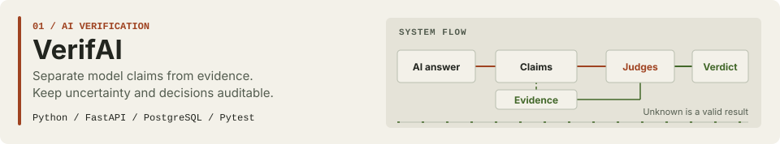

<!-- AP/2717 • Original, locally generated SVGs. No external stats providers. -->
<picture>
  <source media="(prefers-color-scheme: dark)" srcset="assets/identity-dark.svg">
  
</picture>

[Portfolio](https://arunprasath.me) · [LinkedIn](https://www.linkedin.com/in/arun-prasath-p-6ar01333/) · [LeetCode](https://leetcode.com/u/_Arun_Prasath_07_/) · [Email](mailto:arunprasath6035@gmail.com)

I'm a CSE student at Sri Shakthi Institute, interested in the systems that sit between raw data and a useful decision. Most of my work uses Python and FastAPI, with NLP, retrieval or evaluation in the processing layer. I'm working toward MLOps: versioned models, reproducible builds, reliable APIs and deployments that can be inspected when they fail.

## Selected work

<a href="https://github.com/Arunprasath-2717/VerifAI">
  <picture>
    <source media="(prefers-color-scheme: dark)" srcset="assets/verifai-dark.svg">
    
  </picture>
</a>

**VerifAI** separates what a language model said from what the available evidence supports. It compares model responses, extracts checkable claims and preserves a verification trail rather than treating agreement as truth.

The architecture uses independent judges, an explicit unknown state and local BM25 retrieval as a fallback. The repository documents security controls and CI quality gates.

[Source](https://github.com/Arunprasath-2717/VerifAI) · [Case study](https://arunprasath.me/work/verifai) · [Application](https://verifai-mauve.vercel.app/)

<a href="https://github.com/Arunprasath-2717/VOILORACLE">
  <picture>
    <source media="(prefers-color-scheme: dark)" srcset="assets/atlox-dark.svg">
    
  </picture>
</a>

**Atlox AI (VOILORACLE)** turns scattered news coverage into grouped events, searchable entities and sentiment signals. It uses multi-source ingestion, deduplication, NLP and event clustering.

The engineering choice that matters here is density-based clustering: the number of events isn't known in advance. A Redis-backed queue separates ingestion from processing, with an in-memory fallback for local runs.

[Source](https://github.com/Arunprasath-2717/VOILORACLE) · [Case study](https://arunprasath.me/work/atlox-ai) · [Application](https://veiloracle.vercel.app/)

## Engineering toolkit

<picture>
  <source media="(prefers-color-scheme: dark)" srcset="assets/toolchain-dark.svg">
  
</picture>

**Current focus:** packaging ML workloads, model serving, experiment tracking and evaluation, container orchestration, infrastructure as code and production monitoring.

## Experience & education

| Year | Record |
| :--- | :--- |
| 2024–2028 | B.E. Computer Science & Engineering — Sri Shakthi Institute of Engineering and Technology |
| 2025 | Full-stack web development internship — Ascentz Technologies |
| 2025 | AI/ML internship — Pluto Academy |
| 2025 | Full-stack web development internship — Thiranex |
| 2026 | 2nd place, Code Rush — Kanam 2K26, NGP College |
| 2026 | Event lead, Render Rush — Kalam 2026 |

## Development activity

<picture>
  <source media="(prefers-color-scheme: dark)" srcset="assets/activity-dark.svg">
  
</picture>

Contribution data is fetched from GitHub every six hours. The chart uses a linear scale, and the original weekly values are stored in <a href="data/contributions.json">the repository</a>. Project animations illustrate architecture, not live traffic.

---

Open to software engineering internships in backend, platform engineering and applied AI.

[Explore all repositories](https://github.com/Arunprasath-2717?tab=repositories) · [Portfolio](https://arunprasath.me) · [Connect on LinkedIn](https://www.linkedin.com/in/arun-prasath-p-6ar01333/)
